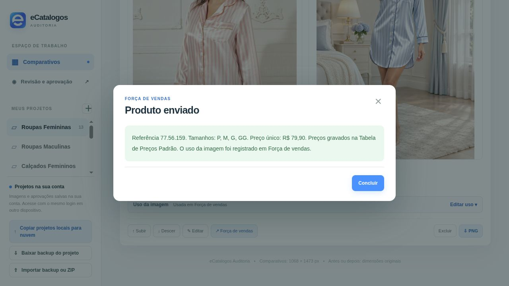
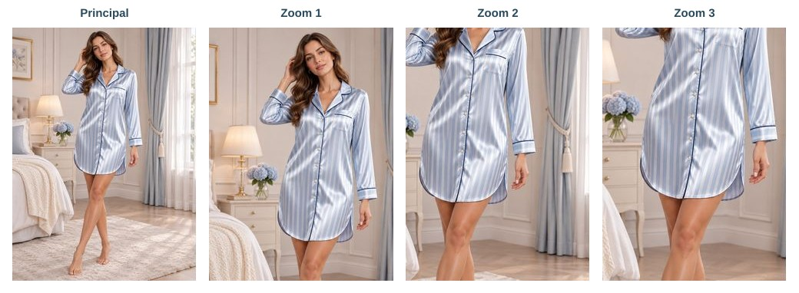

# Cadastro de produtos no Força de vendas

Regras definidas pelo responsável para o formulário de integração:

- Estoque inicial: **6.000 por tamanho**, em `stockForca` e `stockB2B`.
- Prazo de entrega: sempre **PE**, localizado na API pelo nome e vinculado ao produto pelo ERP correspondente. No ambiente validado, o ERP do prazo é `1`.
- **Pronta entrega = Sim** e produto **Visível no aplicativo Força de vendas**. Esses padrões são fixos no formulário.
- Preço único por produto: preencher uma vez e replicar para todos os tamanhos, incluindo os preços vinculados à tabela.
- Usar sempre a **Tabela de Preços Padrão** já existente na empresa. Não criar uma tabela nova por produto nem selecionar as tabelas “Feira” por semelhança de nome.
- Referência: exatamente **00.00.000**, com sete dígitos e dois pontos. Validar com `/^[0-9]{2}\.[0-9]{2}\.[0-9]{3}$/` e consultar a disponibilidade antes do cadastro. O código ERP é um identificador separado.
- Cada SKU recebe um código de exatamente **16 dígitos numéricos**, mantido como string para evitar perda de precisão.
- Grade inicial: P, M, G e GG; os tamanhos podem ser ajustados antes do cadastro.

## Exemplo validado em 17/11/2026

Ambiente: `https://dev.api.forca-de-vendas.e-catalogos.net`.

- Produto: Pijama de demonstração — Auditoria.
- Referência: `90.00.001`.
- ERP do produto: `AUD-PIJ-001`.
- Marca de demonstração: `AUD001`.
- Variante: `AUD-PIJ-001-AZUL`.
- SKUs: `AUD-PIJ-001-P`, `AUD-PIJ-001-M`, `AUD-PIJ-001-G` e `AUD-PIJ-001-GG`.
- Tabela de destino confirmada: **Tabela de Preços Padrão**, ERP `erp-feiras`. Os quatro preços do pijama já foram gravados nela.
- Preço de exemplo: R$ 79,90 em todos os tamanhos.

Os cadastros e os estoques foram consultados novamente após a gravação. O formulário está disponível pelo botão **Força de vendas** de cada comparativo aprovado, na galeria ou na revisão. O exemplo inicial foi criado diretamente pela API. A foto enviada no teste é uma imagem de pijama azul já aprovada na Auditoria.

## Comportamentos observados na API

- `PATCH /skus/stock` recebe um array com `erpId`, `stockForca` e `stockB2B`. Conferir cada SKU após o envio; o endpoint também documenta resposta 207 para falhas parciais.
- Neste ambiente, `PUT /products` retornou sucesso, mas manteve a referência antiga. O reenvio por `POST /products`, com o mesmo `erpId` e a nova referência, atualizou o mesmo produto; a consulta confirmou uma única ocorrência da referência nova e nenhuma da antiga.
- O campo `st` precisa ser string, apesar de uma divergência no schema da documentação.
- Usar códigos ERP curtos para os vínculos de preço: a API compõe o identificador com o código da tabela e pode ultrapassar o limite da coluna.
- A tabela padrão inicialmente não tinha ERP. O responsável configurou o código `erp-feiras`, que foi validado pela API. A integração fixa esse destino e não cria tabelas de preço.
- `POST /images` identifica o produto pelo nome `<ERP do produto>--1.jpg`, e não pela referência comercial. O nome com referência retornou produto não encontrado; o nome com ERP foi aceito e confirmou o vínculo.
- O upload recusou a imagem original de 2,4 MB. A integração prepara uma cópia JPEG com até 900 KB e até 2000 px de lado; os arquivos da Auditoria não são substituídos.
- Falhas podem ser retomadas com os mesmos códigos de produto, variante e tamanho. SKUs existentes não têm seu estoque reiniciado. O uso em Força de vendas só é marcado após o sucesso de todas as etapas, incluindo a foto.
- As credenciais devem ficar no servidor. Não gravar senhas ou tokens no frontend ou neste documento.

## Configuração no servidor

As variáveis estão descritas em `.env.example`. A configuração local está no `.env.local` ignorado pelo Git. Na Vercel, importe esse arquivo em **Environment Variables**, selecione o ambiente desejado e faça novo deploy. As variáveis `FORCA_*` não devem ter prefixo `VITE_`.

- `FORCA_API_BASE`: URL da API pública. Localmente foi validado o ambiente de desenvolvimento.
- `FORCA_API_EMAIL` e `FORCA_API_PASSWORD`: credenciais da integração.
- `FORCA_COMPANY_KEY`: chave da empresa, no exemplo `2000`.
- Qualquer usuário logado no Auditoria pode publicar suas próprias imagens aprovadas. A variável antiga `FORCA_ALLOWED_USER_IDS` não é mais utilizada, mesmo que ainda esteja definida na Vercel.

O backend verifica a sessão do Supabase, o proprietário do comparativo e a aprovação, e baixa a imagem do Storage privado. Não utiliza chave `service_role`. Não é necessária migração SQL adicional: o uso é registrado nos campos existentes. O formulário exige acesso ao servidor (`npm run dev` ou Vercel); o HTML portátil mantém os demais recursos, mas não hospeda essa API.

Os cadastros de marca, filial, gênero e categoria precisam ter códigos ERP para serem selecionados. Uma categoria nova pode ser criada no próprio formulário, dentro da marca escolhida. O nome da cor/variante é informado em texto, como “Azul”. A integração permite uma variante por produto neste fluxo inicial.

## Envio confirmado pelo formulário do Auditoria

Em 17/11/2026, a versão local do app cadastrou **Pijama azul**, referência **77.56.159**, diretamente pelo botão da galeria. A API confirmou a foto do produto e quatro SKUs com estoque de 6.000 e preço R$ 79,90 na tabela padrão `erp-feiras`. Os quatro códigos foram conferidos por consulta posterior e têm 16 dígitos numéricos. O registro de uso em Força de vendas foi salvo no Supabase, preservando o texto anterior de uso.

## Prazo e disponibilidade

O cadastro inclui `deadlineErpId` e `promptDelivery: true`. Também executa `PATCH /deadlines/products` e exige confirmação de que o produto foi atualizado. Uma consulta posterior valida o prazo, a pronta entrega e a visibilidade; falhas nessa etapa não registram um envio concluído. Na retomada, a visibilidade no Força de vendas pode ser reativada preservando a configuração de B2B.

Os dois pijamas de exemplo, referências `90.00.001` e `77.56.159`, foram vinculados ao prazo **PE** e consultados novamente em 17/11/2026. Ambos retornaram prazo ERP `1`, pronta entrega habilitada e visibilidade no Força de vendas habilitada.

## Galeria com zoom automático

Cada envio prepara quatro imagens da mesma fonte: a principal completa e três recortes com níveis de zoom e posições variadas. Os recortes mantêm as proporções da imagem. O sorteio é estável para o mesmo produto e arquivo, de modo que uma retomada conserva os mesmos detalhes.

Os arquivos usam as ordens 1, 2, 3 e 4, com nomes `<ERP do produto>--1.jpg` até `<ERP do produto>--4.jpg`. O envio é separado por arquivo para respeitar o limite do servidor. Cada imagem precisa ter o vínculo e a ordem confirmados pela API antes de concluir o cadastro.

Os detalhes do Pijama azul, referência **77.56.159**, foram enviados e confirmados nas ordens 2, 3 e 4, complementando a foto principal existente.

Se a API responder que uma ordem já tem imagem, a integração mantém essa foto e completa somente as posições faltantes. Não substitui fotos existentes. O aviso de retomada e a confirmação informam quando a galeria já continha imagens. O conflito só é aceito como posição preenchida quando a resposta identifica exatamente a ordem enviada; outros erros continuam bloqueando a conclusão.

A prévia acima ilustra os recortes gerados pela versão atual. As fotos de detalhe já enviadas anteriormente ao exemplo continuam no produto, conforme a regra de preservação de imagens existentes.
